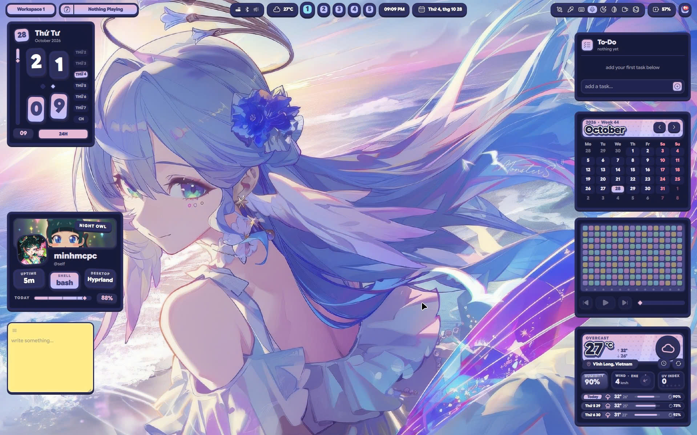
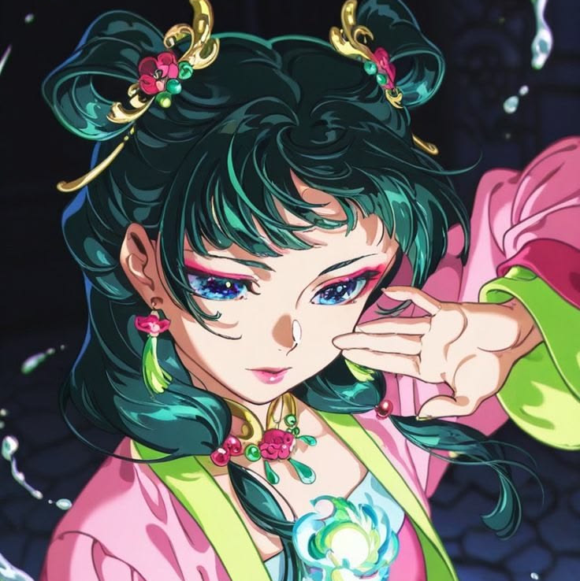
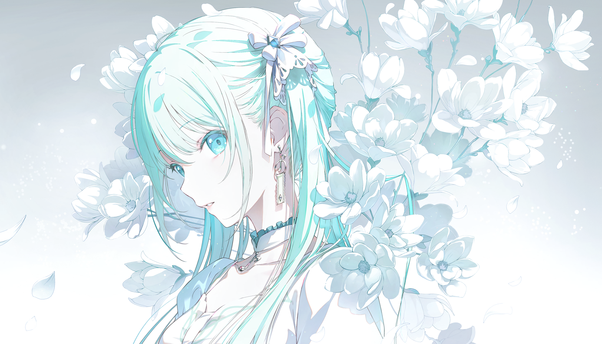

<div align="center">



<br>
<h1>minhmcpc</h1>

<b>Full-Stack Developer • System Engineer • Minecraft & Tooling Specialist</b><br>
Founder @ <a href="https://studio.minhmcpc.io">Corelinks Studio</a> • Community @ <a href="https://discord.gg/swordland">Swordland</a> • Docs @ <a href="https://minhmcpc.fun/tutorial/">Ptero Docs</a><br>
<i>"code kh chạy là do ý trời"</i>

---

### 🛠️ Languages & Technologies


</div>

---

> [!NOTE]
> 📌 **Credits**: Repository layout, workflows & aesthetic structure are forked and adapted from [**akk1to/akk1to**](https://github.com/akk1to/akk1to). Special thanks to [@akk1to](https://github.com/akk1to) for the inspiring profile setup!

---

# 👨‍💻 About Me

Xin chào! Mình là **MinhMCPC** — lập trình viên đam mê kiến trúc hệ thống, phát triển server & công cụ mã nguồn mở từ Việt Nam 🇻🇳.

- 🏢 **Founder @ [Corelinks Studio](https://studio.minhmcpc.io)**: Phát triển các sản phẩm công nghệ & giải pháp hạ tầng máy chủ.
- 🏰 **Owner @ [Swordland](https://discord.gg/swordland)**: Không gian giao lưu của cộng đồng game thủ & developer.
- ⚙️ **Minecraft & Game Server Engineering**:
  - Tác giả [**pterodactyl-addons**](https://github.com/MinhMCPC/pterodactyl-addons): Bộ addon mã nguồn mở miễn phí cho hệ thống quản trị máy chủ Pterodactyl.
  - Tác giả [**Java2Bedrock**](https://github.com/MinhMCPC/Java2Bedrock): Công cụ chuyển đổi thế giới Minecraft giữa Java Edition và Bedrock Edition.
  - Tác giả [**AuthMePE**](https://github.com/MinhMCPC/AuthMePE): Plugin tích hợp xác thực tài khoản cho Minecraft Pocket Edition.
- 🤖 **AI & Cloud Orchestration**: Thiết kế nền tảng **Aegis-Agent** điều phối tác vụ phân tán, chạy container sandbox bảo mật cao.
- 🐧 **Linux Power User**: Sử dụng **EndeavourOS** (Arch Linux) kết hợp Tiling Window Manager **Hyprland** (tùy biến giao diện theo phong cách Project Sekai & Anime).
- 💡 **Châm ngôn sống**: *"code kh chạy là do ý trời, còn fix được hay không là do kiên trì."*

---

## 📬 Contact & Socials

<p align="left">
  <a href="https://minhmcpc.fun" target="_blank"></a>
  <a href="https://discord.gg/swordland" target="_blank"></a>
  <a href="https://studio.minhmcpc.io" target="_blank"></a>
  <a href="https://minhmcpc.fun/tutorial/" target="_blank"></a>
  <a href="https://github.com/MinhMCPC" target="_blank"></a>
</p>

---

## 📊 GitHub Stats

<p align="center">
  
  
</p>
<p align="center">
  
</p>

## 🏆 GitHub Achievements

<p align="center">
  
</p>

---

## 📌 Featured Projects

<p align="center">
  <a href="https://github.com/MinhMCPC/pterodactyl-addons">
    
  </a>
  <a href="https://github.com/MinhMCPC/Java2Bedrock">
    
  </a>
  <br>
  <a href="https://github.com/MinhMCPC/AuthMePE">
    
  </a>
  <a href="https://github.com/MinhMCPC/minhmcpc.github.io">
    
  </a>
  <br>
  <a href="https://github.com/MinhMCPC/Aegis-Route">
    
  </a>
  <a href="https://github.com/MinhMCPC/Infrarust">
    
  </a>
</p>

---

## 💻 About My Workspace

```
                     ./o.                   minhmcpc@self
                   ./sssso-                 -------------
                 `:osssssss+-               OS: EndeavourOS x86_64
               `:+sssssssssso/.             Host: GIGABYTE GAMING A16 CVH (-CF)
             `-/ossssssssssssso/.           Kernel: Linux 6.18.58-1-lts
           `-/+sssssssssssssssso+:`         Uptime: 1 hour
         `-:/+sssssssssssssssssso+/.        Packages: 29 (flatpak), 1340 (pacman)
       `.://osssssssssssssssssssso++-       Shell: bash 5.3.20
      .://+ssssssssssssssssssssssso++:      Display (BOE0B77): 1920x1200 in 16", 165 Hz [Built-in]
    .:///ossssssssssssssssssssssssso++:     Window Manager: Hyprland 0.56.2
  `:////ssssssssssssssssssssssssssso+++.    Theme: sekaipop-adw-gtk3-dark [GTK2/3/4]
`-////+ssssssssssssssssssssssssssso++++-    Icons: breeze-dark [GTK2/3/4]
 `..-+oosssssssssssssssssssssssso+++++/`    Cursor: Bibata-Modern-Classic (24px)
   ./++++++++++++++++++++++++++++++/:.      Terminal: kitty 0.49.2
  `:::::::::::::::::::::::::------``        CPU: 13th Gen Intel(R) Core(TM) i7-13620H (12+4) @ 4.90 GHz
                                            GPU 1: NVIDIA GeForce RTX 5060 Max-Q / Mobile [Discrete]
                                            GPU 2: Intel UHD Graphics @ 1.50 GHz [Integrated]
                                            Memory: 6.32 GiB / 15.25 GiB (41%)
                                            Swap: Disabled
                                            Disk (/): 53.19 GiB / 115.59 GiB (46%) - ext4
                                            Disk (/mnt/c): 122.12 GiB / 149.12 GiB (82%) - ntfs3
                                            Disk (/mnt/d): 160.39 GiB / 206.73 GiB (78%) - ntfs3
                                            Battery (GAD-640): 70% [AC Connected, Charging]
                                            Locale: en_US.UTF-8
```

<p align="center">
  
</p>

---

## 🎮 Games & Interests

- ⚔️ **Genshin Impact**: Trải nghiệm mượt mà trên Linux qua Heroic Games Launcher
- ⛏️ **Minecraft**: Quản trị server, dev plugin & addon, thiết lập mạng proxy (AuthMePE, Java2Bedrock)
- 🎵 **Project Sekai: Colorful Stage!**: Nhịp điệu âm nhạc & nguồn cảm hứng phối màu giao diện
- 💊 **Anime**: *Dược Sư Tự Sự* (*The Apothecary Diaries* / Mao Mao)

---

## 🗃️ Recent GitHub Activities

<!--START_SECTION:activity-->

<!--END_SECTION:activity-->

---

<p align="center"> 
  👀 Profile Visitor Count<br>
  <br>
</p>

***

<p align="center">
  ✨ Thank you for visiting my profile! ✨<br>
  Xem thêm các dự án tại: <a href="https://minhmcpc.fun"><b>minhmcpc.fun</b></a><br>
  Tham gia cộng đồng: <a href="https://discord.gg/swordland"><b>Swordland Discord</b></a>
</p>


---

<p align="center">
  💡 <i>Forked and adapted from <a href="https://github.com/akk1to/akk1to"><b>akk1to/akk1to</b></a></i><br>
  Copyright © 2026 MinhMCPC. Powered by EndeavourOS & Hyprland.
</p>
