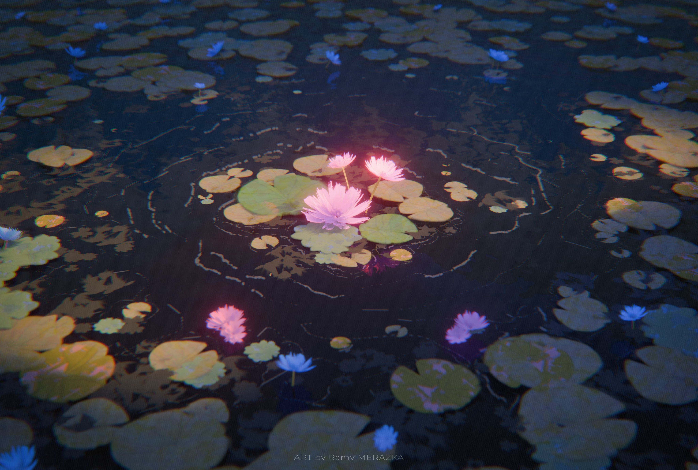

# Welcome to my profile!
Hello world! I'm **MinhMCPC**, a software developer & system enthusiast from Vietnam 🇻🇳!
I'm addicted to building applications, tinkering with game servers, and architecting distributed automation systems (and breaking them along the way lmao).

I love low-level engineering, Linux customizations, competitive programming, and Minecraft server orchestration. If you are interested in collaborating, building open-source projects, or exploring tech together, welcome aboard!

***

## 📌 Some infos about me:
* 🌐 **Website**: [**minhmcpc.fun**](https://minhmcpc.fun)
* 🏢 **Studio**: Founder @ [**Corelinks Studio**](https://studio.minhmcpc.io)
* 🏰 **Community**: Owner @ [**Swordland Discord**](https://discord.gg/swordland)
* 📖 **Documentation**: [**Pterodactyl SFTP & Server Guide**](https://minhmcpc.fun/tutorial/)
* 📍 **Location**: Vietnam (Timezone: GMT+07, Asia/Ho_Chi_Minh)
* 💻 **Primary Machine**: GIGABYTE GAMING A16 CVH running **EndeavourOS (Linux 6.18 LTS)**
* 🖥️ **Desktop Environment**: Custom **Hyprland** with SekaiPop & Project Sekai aesthetic
* 🎮 **Games**: Genshin Impact, Minecraft (server administration & modding), Project Sekai
* 🌸 **Favorite Anime**: *The Apothecary Diaries* (*Kusuriya no Hitorigoto* / Mao Mao)
* 💡 **Life Mantra**: *"code kh chạy là do ý trời"*

***

## 📈 My GitHub Stats
<p align="center">
  
  
  <br><br>
  <a href="https://github.com/MinhMCPC/pterodactyl-addons">
    
  </a>
  <a href="https://github.com/MinhMCPC/Java2Bedrock">
    
  </a>
  <br>
  <a href="https://github.com/MinhMCPC/AuthMePE">
    
  </a>
  <a href="https://github.com/MinhMCPC/minhmcpc.github.io">
    
  </a>
  <br>
  <a href="https://github.com/MinhMCPC/Aegis-Route">
    
  </a>
  <a href="https://github.com/MinhMCPC/Infrarust">
    
  </a>
</p>

***

## 💻 About my workspace
```
Host: GIGABYTE GAMING A16 CVH (-CF)
CPU: 13th Gen Intel(R) Core(TM) i7-13620H @ up to 4.90GHz (12 Cores / 16 Threads)
GPU 1: NVIDIA GeForce RTX 5060 Max-Q / Mobile (GDDR6)
GPU 2: Intel UHD Graphics @ 1.50 GHz (Integrated)
RAM: 16 GB DDR5 RAM
SSD: NVMe PCIe Gen 4.0 (ext4 root + NTFS storage)
Display: 16" WUXGA (1920x1200) @ 165Hz IPS
OS: EndeavourOS Linux x86_64 (Kernel: Linux 6.18.58-1-lts)
Window Manager: Hyprland 0.56.2 (Custom SekaiPop / PJSekai Rice)
Shell & Terminal: Bash 5.3 + agy / Foot / Alacritty
Customization: Waybar + Hyprpaper + Hypridle + Sekai Theme Overrides
```

<p align="center">
  
</p>

***

## 🖼️ Wallpaper & Aesthetic Gallery

<p align="center">
  
  
</p>

***

## ⏱️ My WakaTime status
<p align="center">
  
</p>

***

## 🏆 GitHub Trophies
<p align="center">
  <a href="https://github.com/ryo-ma/github-profile-trophy">
    
  </a>
</p>

***

## 🎮 Games I'm playing
* **Genshin Impact**: Running smoothly on Linux with Heroic Games Launcher
* **Minecraft**: Server administrator & plugin developer (AuthMePE, Java2Bedrock, Luminol, PaperMC)
* **Project Sekai**: Colorful Stage enthusiast & UI theme inspiration

***

## 🗳️ Community Voting Pool
**Question:** Rate my profile README?

<div align="center">

|☆|☆☆|☆☆☆|☆☆☆☆|☆☆☆☆☆|
|-|-|-|-|-|
|0|0|0|0|0|

</div>

***

## 📬 Contact me through

<p align="left">
  <a href="https://minhmcpc.fun" target="_blank"></a>
  <a href="https://discord.gg/swordland" target="_blank"></a>
  <a href="https://github.com/MinhMCPC" target="_blank"></a>
</p>

***

## 🗃️ Recent activities

<!--START_SECTION:activity-->
<!--END_SECTION:activity-->

***

<p align="center"> 
  Visitor count<br>
  <br>
</p>

***

<p align="center">
  Thank you for visiting my profile!<br>
  More information can be found on my website: <a href="https://minhmcpc.fun"><b>minhmcpc.fun</b></a><br>
  Join our community: <a href="https://discord.gg/swordland"><b>Swordland Discord</b></a>
</p>


---

<p align="center">Copyright © 2026 minhmcpc.fun</p>
